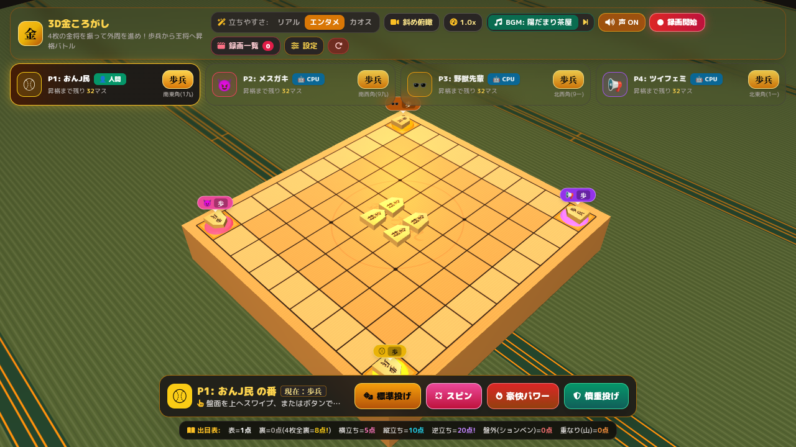

# 3D金ころがし（まわり将棋）オールスターズ 🎲☖

ブラウザ上で今すぐ遊べる、本格3D物理演算を用いた「まわり将棋（金ころがし）」対戦ボードゲームです。  
Three.js と Cannon.js を駆使し、4枚の金将が盤上でぶつかり転がるリアルな挙動（表・裏・横立ち・縦立ち・逆立ち・ションベン）をシミュレーション！  
PCはもちろん**スマートフォンの縦画面・横画面にも完全最適化**されており、個性豊かなキャラクターによるフルボイス掛け合い、**完全ロイヤリティフリーの和風BGM（全3曲＋カスタム音源読込）**、充実したローカルルール設定、プレイ動画の自動合成・録画機能を備えたシングルページWebアプリケーションです。

---

## 🎮 今すぐプレイ（GitHub Pages）

👉 **[https://dma-cmyk.github.io/3dkinkorogashi/](https://dma-cmyk.github.io/3dkinkorogashi/)**

> インストール不要。PCおよびスマートフォンのモダンブラウザ（Chrome, Edge, Safari, Firefox等）でそのまま快適に遊べます。

[](https://dma-cmyk.github.io/3dkinkorogashi/)

---

## 🌟 主な機能と特徴

### 1. 3D物理演算によるリアルな金将投擲
- **Three.js + Cannon.js** による精緻な3Dグラフィックと剛体物理シミュレーション。
- スワイプの方向や強さ、プリセットボタン（スピン投げ・パワー投げ・安全投げ等）によって駒の回転や軌道が変化。
- **立ちやすさアシストモード**:
  - **リアル**: 物理法則に忠実。滅多に立たない超シビアモード。
  - **エンタメ（デフォルト）**: 横立ちや縦立ちが適度に出現し、白熱した勝負が楽しめる推奨モード。
  - **カオス**: 驚異の立ち率を誇る超高速・大波乱モード。

### 2. まわり将棋の出目判定
投擲された4枚の金将の停止姿勢を自動検知して出目を算出します。

| 出目 | 得点 | 説明 |
| :--- | :---: | :--- |
| **表**（金将の文字） | **1点** | 通常の表向き（1点×枚数） |
| **裏**（無地） | **0点** | 文字のない裏向き |
| **全裏**（4枚すべて裏） | **8点** | 4枚すべて裏が出た場合の大ボーナス！ |
| **横立ち** | **5点** | 駒が側面の細いエッジで自立 |
| **縦立ち** | **10点** | 底面を下にして直立 |
| **逆立ち** | **20点** | 尖った先端を下にして奇跡の自立 |
| **ションベン**（盤外落下） | **0点** | 将棋盤の外へ転がり落ちると無効（0点） |

### 3. 本格ローカルルール＆昇格システム
- **階級の昇格（ランクアップ）**:
  - 将棋盤の外周（全32マス）を1周するごとに階級が昇格します。
  - **高速モード（4段階）**: `歩兵` ➔ `銀将` ➔ `飛車` ➔ `王将`
  - **通常モード（7段階）**: `歩兵` ➔ `香車` ➔ `桂馬` ➔ `銀将` ➔ `角行` ➔ `飛車` ➔ `王将`
  - 最終階級の「王将」で盤を1周してゴールすれば勝利！
- **おんぶルール**:
  - 進行先で他のプレイヤーと同じマスにぴったり止まると、そのプレイヤーの駒の上に「おんぶ（相乗り）」します。
  - 下のプレイヤーが移動する際、上に乗っている駒も一緒に自動で運ばれます！
- **角ワープ**:
  - 四隅の角マスにぴったり止まると、次の角マスへ一気にワープしてショートカット！
- **重なり後退ペナルティ（設定可）**:
  - 振った金将同士が重なった場合、出目分後退するスリリングなルール。

### 4. 個性あふれる4人の参戦キャラクター＆実況
CPU対戦・人間プレイヤーの切り替えが可能。各キャラ固有の投擲スタイル、掛け合いボイス、カットイン字幕を搭載。

| アイコン | キャラクター | 投擲スタイル | 特徴 |
| :---: | :--- | :--- | :--- |
| ⚾ | **おんJ民** | 豪快パワー＆乱れ投げ | 勢いよく広範囲に投擲。猛虎魂で突き進む。 |
| 😈 | **メスガキ** | 技巧派・横回転スピン | 横回転を与えて「横立ち（5点）」を積極的に狙う。 |
| 🕶️ | **野獣先輩** | 重撃パワー型 | 強力に叩きつけ、「縦立ち・逆立ち」を狙う（盤外注意）。 |
| 📢 | **ツイフェミ** | 慎重・密集型 | 力を抑えて投擲し、盤外落下を防ぐ手堅いスタイル。 |

### 5. ロイヤリティフリー和風BGM＆実況サウンドシステム
- **内蔵フリー和風BGM（全3曲・MIT/CC0完全適合）**:
  - 物理モデリング撥弦（Karplus-Strong 箏・三味線・ウッドベース）、篠笛、和太鼓、拍子木を Web Audio API 上でリアルタイム生成・演奏（外部音源通信ゼロ・単一HTML完結）。
  - **🌸 陽だまり茶屋**（陽旋法・軽快でのどかな対局曲）
  - **🏮 祭囃子バトル**（民謡音階・威勢の良いお祭りテンポ）
  - **🌙 月夜の真剣勝負**（都節音階・緊張感あふれる勝負曲）
  - キャラクターが喋る際は自動でBGM音量を絞る**オートダッキング**を搭載。さらに**手持ちのMP3/WAV/OGG等の音楽ファイルを読み込んでBGMにする機能**にも対応。
- **効果音＆実況フルボイス**:
  - **Web Audio API** によるリアルな木駒の激突音・ファンファーレ。
  - **Web Speech API** および自作フォルマント音声シンセサイザーによる実況ボイス（ローカル **VOICEVOX** 連携にも対応）。

### 6. スマートフォン完全対応（縦画面・横画面）
- **自動カメラフレーミング**: スマホ縦持ち・横持ち・タブレット・PCのアスペクト比に応じて、視野角（FOV）とカメラ距離を幾何学的に自動調整。小さな縦画面でも将棋盤の外周32マスと四隅の駒が見切れません。
- **片手操作スリムUI**: スマホでは1行クイックヘッダー、名前が見切れない4列スリムカード、盤面を隠さない上部カットイン字幕、ドロワーメニューに自動切替。CPUターン中は下部ボタンを自動で折りたたみ盤面を広く表示します。
- **マルチタッチ対応**: 1本指スワイプでリアルタイムの「強さ％」ゲージ＆やり直しキャンセル、2本指ピンチでズームイン／アウト＆アングル回転が可能。

### 7. ブラウザ内蔵 録画スタジオ（クリップ保存）
- 3D盤面映像、実況字幕カットイン、出目ポップアップ、ボイス＆**和風BGM**をリアルタイムに1つの動画キャンバスに合成。
- 画面上部の「🔴 録画開始」ボタン（スマホはメニュー内）を押すだけで、BGM付きのプレイ動画を即座に録画・プレビュー・ダウンロード（WebM/MP4形式）可能。

---

## 🕹️ 操作方法

- **投擲操作**:
  - **スワイプ**: 将棋盤上をタッチ／ドラッグして上へスワイプすると、矢印の方向とリアルタイム強度ゲージ（％）に応じて駒を投げます（指を開始点へ戻して離せばキャンセル可能）。
  - **プリセットボタン**: 画面下の「標準投げ」「スピン」「豪快パワー」「慎重投げ」ボタンからワンタップでも投擲可能。
- **カメラ操作**:
  - 画面上部のカメラボタンで「斜め俯瞰」「真上見下ろし」「ダイナミックアクション」に切り替え。
  - スマホでは**2本指ピンチでズーム**・2本指ドラッグ（または盤面外ドラッグ）で回転、PCでは右ドラッグ／Shift+ドラッグで回転・マウスホイールでズームが可能。
- **BGM・各種設定**:
  - 「BGM ON/OFF・曲切替（🌸茶屋 / 🏮祭囃子 / 🌙真剣勝負 / 手持ちMP3読込）・音量スライダー」
  - 「立ちやすさ（リアル / エンタメ / カオス）」
  - 「ゲーム速度（1.0x / 1.5x / 2.0x）」
  - 「声 ON / OFF」
  - 「キャラ＆ルール設定モーダル」（各スロットの人間/CPU切替、キャラクター選択、ワープやおんぶのON/OFF）

---

## 🛠️ 技術スタック

- **3Dグラフィックス**: [Three.js](https://threejs.org/) (r128)
- **3D物理エンジン**: [Cannon.js](https://schteppe.github.io/cannon.js/) (v0.6.2)
- **UIスタイリング**: [Tailwind CSS](https://tailwindcss.com/) (CDN)
- **アイコン**: [FontAwesome 6](https://fontawesome.com/)
- **フォント**: Google Fonts (M PLUS Rounded 1c, Noto Serif JP)
- **オーディオ / ボイス**: Web Audio API (Master Bus, Formant Synth), Web Speech API, VOICEVOX API
- **メディア録画**: HTML5 Canvas Composite, MediaRecorder API

---

## 📂 ファイル構成

```
.
├── index.html       # メインエントリーポイント（GitHub Pages用）
├── 3d.html          # ソースHTML
├── screenshot.png   # ゲーム画面スクリーンショット
├── LICENSE          # MITライセンス
└── README.md        # プロジェクト説明ドキュメント
```

---

## 📜 ライセンス

本プロジェクトは [MIT License](LICENSE) のもとで公開されています。
個人利用、実況配信、改変などご自由にお楽しみください。
